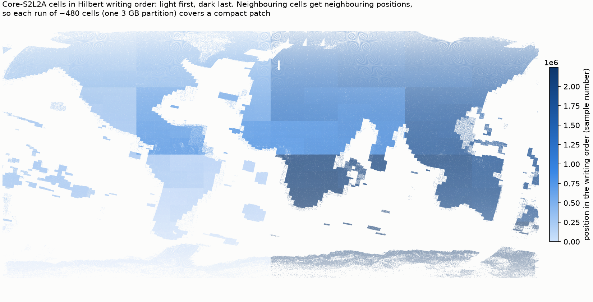

> **CLAUDE-GENERATED DOCUMENT** — automated LLM-generated content. Verify before relying on it.

> **Review status:** draft for review (Miko and the TACO / rumi / GeoZL maintainer), 2026-10-24. Updated 2026-10-26 after the review meeting with Cesar and the benchmarks (sections 2-7, 10). Design only; no code yet.

# Releasing Major TOM datasets — design

How built Major TOM samples become a published dataset: raster payloads (rumi lossless by default; COG as an option, section 5), TACO containers, and upload to source.coop (Hugging Face optional). A new module, `majortom.release`, with an extra `[release]`, alongside `majortom.build`. First target: a new version of Sentinel-2 Core on source.coop.

## 1. Flow

```
majortom.build output: one sample per cell (bands as arrays + JSON sidecar: CRS, transform, times, sources)
  -> raster groups by pixel size (Sentinel-2: 10 m, 20 m, 60 m)
  -> payload writers: rumi per group (default) and/or COG per group (the profile of section 3)
  -> TACO FOLDER: contract (structure + metadata levels) + samples
  -> partitions: samples written in Hilbert order, cut by taco-eo into ZIPs of just under 3 GB (section 7)
  -> TACOCAT: consolidated metadata over the partitions, opened as one collection
  -> upload: source.coop (default), Hugging Face (option)
```

## 2. Decisions so far (Miko, 2026-10-24)

| Topic | Default | Options |
|---|---|---|
| Payload | **rumi, lossless** (Miko, 2026-10-26, after the benchmark in section 10; as Core-DEM) | COG: release with `payload="cog"` or `"both"`, read any rumi sample as a COG, convert a selection to COG files (section 5) |
| Compression | lossless | near-lossless, heavily lossy (section 4) |
| Container | TACO ZIP partitions + TACOCAT; built as FOLDER | — |
| Partitions | taco-eo's size cut (just under 3 GB per ZIP) over samples written in Hilbert order (section 7) | the limit is a parameter |
| Raster groups | one file per pixel size | — |
| Destination | source.coop | Hugging Face |
| zarr | not used for sample releases | data cubes (many dates per cell), later |
| Climate datasets | plain partitioned parquet, not TACO | — |
| Overviews | none | on request (map viewers) |

## 3. The Major TOM COG profile

The COG option (section 5) writes every raster group with one profile. It is chosen for analysis and GIS use (band subsets, windows), with training reads still fast. Each setting below gives its reason and, where measured, the evidence (section 10 and the band-subset test of 2026-10-26).

```
driver=COG  BLOCKSIZE=176  INTERLEAVE=TILE  COMPRESS=ZSTD  PREDICTOR=2 (integers) / 3 (floats)  OVERVIEWS=NONE
dtype as delivered; NODATA, band descriptions, scale and offset, CRS and the corrected geotransform set per file
GDAL >= 3.11 (rasterio >= 1.5 wheels bundle GDAL 3.12); the writer reads the file back and fails unless INTERLEAVE=TILE
```

### 3.1 Why 1056 px, and tiles of 176 px

The sample is 1056 px at 10 m (10,560 m): the v2 window (docs/SPEC.md section 3), whose side is the smallest multiple of 120 m (twice the 60 m lattice, so both edges fall on it) that is at least (1 + 0.056) x 10 km. That number also tiles well:

| Group | Pixels | 1056-px window (v2) | 1068-px window (Core v1) |
|---|---|---|---|
| 10 m | 1056 / 1068 | 6 x 6 tiles of 176 | 6 full + 1 partial tile of 12 px per side: 49 tiles, 13 of them mostly empty |
| 20 m | 528 / 534 | 3 x 3 tiles of 176 | 3 full + 1 partial of 6 px per side |
| 60 m | 176 / 178 | 1 tile | 1 full + 1 partial of 2 px per side |

- TIFF tile sizes must be multiples of 16 (GDAL rejected 168 and 264: "Bad value for TileWidth"; 32 is not required). 1056 = 2⁵ x 3 x 11 has four such divisors: 96, 176, 352, 528. 1068 = 2² x 3 x 89 has none, and neither do 534 or 178: every tile size leaves ragged edge tiles, which cost a request and a decode for a few pixels.
- With 176 px, the tile grids of the three groups nest: one 20 m tile covers exactly 2 x 2 tiles of 10 m, and the 60 m tile covers the whole sample. A window on the ground maps onto the same tile edges in every group.
- Among 96, 176, 352 and 528, 176 balances decode and request counts for random 256 px crops: a crop touches 6.0 tiles of 176 on average and decodes 2.8x its own area (96: 13.4 tiles, 1.9x; 352: 3.0 tiles, 5.6x; 528: 2.2 tiles, 9.4x). Equal ground per tile in all groups would need 96 px at 10 m (16 px at 60 m), with 121 tiles per 10 m image.
- rumi frames use 176 px for the same alignment; 264 px frames (not bound to 16) were no better (section 10, first run).

### 3.2 The other settings

| Setting | Value | Why | Evidence |
|---|---|---|---|
| Interleave | `TILE`: for each tile, every band stored next to each other, each compressed on its own | Reads of band subsets decode only those bands; all bands of a tile are still adjacent in the file (one range request) | 1 band: 587 against 315 crops/s with pixel interleave (1.9x); 3 bands (RGB): equal; all 4 bands: 239 against 283 (16% slower); files 2% larger. Training reads all bands and uses rumi; COG users mostly read subsets. Cesar's recommendation, 2026-10-26 |
| Compression | ZSTD (GDAL's default level, 9) | Fast decode, ratio at least as good as DEFLATE for 16-bit imagery; read by GDAL >= 2.3 and current browsers' COG libraries | Ratio 1.59-1.63 on Sentinel-2 (section 10); against DEFLATE and LZW not measured here |
| Predictor | 2 (horizontal differencing) for integers, 3 (floating point) for floats | Neighbouring pixels are similar, so differences compress better than values | Standard for EO imagery; not measured here |
| Overviews | none | Training and analysis read full resolution; a full pyramid adds about a third to the size. Map viewers can add them (`gdaladdo`) or use `release(..., overviews=True)` | |
| Data type | as delivered (Sentinel-2: uint16, Sentinel-1 RTC: float32, DEM: int16) | No conversion, no rounding | |
| NODATA | the product's own (Sentinel-2: 0) | Missing pixels marked in the file, not only in the sidecar | |
| Metadata | band descriptions (e.g. `B04`), scale and offset per sample (Sentinel-2 L2A: scale 1e-4, offset -1000 from processing baseline 04.00, 0 before), CRS, geotransform | Values interpretable without the sidecar; offsets differ between samples, so they are written per file | |
| Georeferencing | the window's transform on the band's own pixel grid (corrected, docs/SPEC.md 7.2) | Pixels land where they were read | |
| GDAL version | >= 3.11 | `INTERLEAVE=TILE` arrived in GDAL 3.11; GDAL 3.10 silently writes pixel interleave instead (tested), so the writer checks the result | |

## 4. Compression levels

| Level | COG | rumi (GeoZL) |
|---|---|---|
| Lossless (default) | ZSTD + predictor | lossless graph chosen by `geozl.profile` per raster group |
| Near-lossless | plain LERC, `MAX_Z_ERROR` 1-2 DN | `error=1` or `error=2` (absolute bound, `quant_linear`) |
| Heavily lossy | plain LERC with a large bound, e.g. `MAX_Z_ERROR` 20-50 DN | large bounds: relative (`error="5%"`, `quant_log`) or noise-scaled (`quant_sqrt`); profiles by Cesar, pending |

Near-lossless COG uses plain `LERC`, not `LERC_ZSTD` or `LERC_DEFLATE`: Cesar has seen problems with `LERC_ZSTD` (2026-10-26), and the extra layer gains little. Measured on 20 Sentinel-2 samples (60 files, all groups, 176 px tiles, tile interleave; GDAL 3.12.2): every variant kept its bound (worst error exactly 1 or 2, no file over it), and no `LERC_ZSTD` fault appeared here.

| COG compression | Bound | Ratio |
|---|---|---|
| ZSTD + predictor 2 (lossless) | 0 | 1.56 |
| LERC | 1 / 2 DN | 1.90 / 2.15 |
| LERC_ZSTD | 1 / 2 DN | 1.94 / 2.22 |
| LERC_DEFLATE | 1 / 2 DN | 1.96 / 2.23 |

**rumi profiles are named GeoZL graphs** (OpenZL graphs), so new ones can be added without changing the writer. Lossy profiles are still being benchmarked by Cesar (2026-10-26); the first set is lossless plus the near-lossless bounds tried here:

```python
RUMI_PROFILES = {                                   # majortom/release/profiles.py
    "lossless":        GeoZLProfile(graph=None, error=None),   # graph=None: geozl.profile picks the best lossless
    "near-lossless-1": GeoZLProfile(graph=None, error=1),      #   graph per raster group, on a sample of frames
    "near-lossless-2": GeoZLProfile(graph=None, error=2),
    # Cesar's lossy profiles, when ready, e.g. GeoZLProfile(graph="planar>quant_log>zigzag>entropy", error="1%")
}
```

A profile is a GeoZL recipe string (or `None` to profile one per group) and an error bound. When profiling, all of GeoZL's predictor families are tried (`prior=None`; `geozl.profile` tries only the planar family by default): on 12 Sentinel-2 samples the median edge predictor (`med>zigzag>...`) won most frames and gave files ~3% smaller (10 m 3.3%, 20 m 2.8%, 60 m 3.0%). GeoZL's `nodata` node did not help Sentinel-2's zero fill (a frame 57% zeros came out 3% larger with `nodata=0`); it may help float data with NaN gaps (Sentinel-1). The release records, in collection metadata, the profile name, the graph actually used per raster group, the bound, and the rumi and GeoZL versions, so any file can be decoded and re-encoded later.

Heavily lossy COG stays on LERC, not JPEG XL: the rasterio wheels' GDAL has no JPEG XL codec ("missing codec for JXL", GDAL 3.12.2), so writing and every reader would need a JPEG XL-enabled GDAL, which defeats COG's purpose of opening anywhere; LERC also keeps a per-pixel bound. Measured on 20 Sentinel-2 samples (10 m group, uint16; 50 DN = 0.005 reflectance):

| LERC bound | Ratio | Mean error | RMSE |
|---|---|---|---|
| 0 (ZSTD, lossless) | 1.57 | 0 | 0 |
| 5 DN | 2.62 | 2.4 DN | 2.9 DN |
| 20 DN | 3.81 | 9.9 DN | 11.6 DN |
| 50 DN | 5.28 | 25.8 DN | 29.5 DN |

GeoZL's lossy modes are error-bounded quantisation at the head of the graph, then lossless stages; there is no transform codec. So "heavily lossy" in rumi guarantees a per-pixel bound, while JPEG XL in COG does not. The dataset records the level and its bound in collection metadata.

## 5. rumi

**Decision (Miko, 2026-10-26): rumi lossless is the default payload**, as in Core-DEM (`https://source.coop/major-tom/core-dem`: `dem.rumi` per sample, read with `taco.open_dataset(...)` then `rumi.read(location, header)`). The benchmark (section 10) found it 19% smaller than the best COG, ~5.5x faster to write and 1.8x faster for training crops. Sentinel-2 bands stay lossless (Core-DEM uses a 2 m bound); near-lossless and lossy remain options (section 4).

COG stays a first-class option, three ways:

| Need | How | Result |
|---|---|---|
| Publish (or rebuild) a release as COGs | `release(samples, out, payload="cog")`, or `payload="both"` for rumi and COG side by side | the same TACO layout, `cog/<group>.tif` instead of (or beside) `rumi/<group>.rumi`, section 3's COG parameters |
| Open one rumi sample in GDAL-based tools | `majortom.release.read(sample, as_="cog")` | an in-memory GeoTIFF (rasterio `MemoryFile`) with CRS, geotransform, band names, scale and offset from the rumi header |
| Get COG files for part of a rumi release (e.g. for QGIS) | `majortom.release.to_cog(dataset, out, where="...")`, or `python -m majortom.release to-cog <dataset> <out> --where "..."` | one COG per sample and group, section 3's parameters, pixel for pixel equal to the rumi values (lossless) |

Reading, both ways, in the dataset card and the README:

```python
import taco, rumi
ds = taco.open_dataset("https://data.source.coop/major-tom/<dataset>")
rows = ds.sql("SELECT id, \"rumi/10m.rumi::location\" AS loc, \"rumi/10m.rumi::header\" AS hdr FROM ... LIMIT 8")
array = rumi.read(rows.loc[0], rows.hdr[0])                         # (bands, y, x) numpy

from majortom.release import read
with read(rows.iloc[0], as_="cog") as cog, cog.open() as f:        # any rasterio/GDAL code
    print(f.crs, f.transform, f.descriptions)
```

rumi is GPL-3.0 and pre-1.0. It is used before 1.0 (Cesar, 2026-10-26: relatively stable). The release records the rumi and GeoZL versions in its collection metadata, and `to_cog` gives a permissively licensed copy of any part of it.

- One `.rumi` file per raster group per sample, beside or instead of the COG.
- Frames: 176 px, as the COG tiles (section 3.1); 264 px frames were no better in the benchmark.
- Pattern: all bands of a tile in one frame (`b (row h) (col w) -> row col (b h w)`): what training reads, all bands of a window.
- Time: one step per sample (the acquisition time); cubes later.
- Header stored per file in TACO's `children/rumi` level, as in the workshop notebook.

## 6. TACO contract (implemented 2026-10-27: `majortom/release/taco.py`)

`release(samples, out, id=..., description=..., licenses=..., providers=...)` writes built samples of one product as a TACO dataset. taco-eo (0.14.2) does the container, staging, ZIP partitions (by size), TACOCAT, rumi headers and statistics, MajorTOM codes, STAC centroids and validation; `majortom.release` adds the raster groups, the rumi payloads and the writing order.

```
structure:  <group>.rumi per raster group, e.g. 10m.rumi, 20m.rumi, 60m.rumi (Core-DEM: dem.rumi)
sample level:
  id                 MT10km_0624U_0029L_20210714T112119   (Core-DEM's cell code + acquisition; no time: with_time=False)
  stac:*             STAC extension: proj_code, proj_shape, proj_transform (finest group), datetime -> centroid
  majortom:code      MajorTOM extension (dist_km = the grid's d), computed from the centroid
  source:*           from the build sidecar: archive, collection, items, platform, processing_baseline, cloud,
                     cell_coverage, acquired (to the microsecond; rumi keeps whole seconds)
  geoenrich:*        optional: GeoEnrich extension (release(..., geoenrich=[...]); needs network)
children level (per file):
  <file>::location, <file>::header   Rumi extension (as Core-DEM: /vsisubfile/ byte range inside the partition ZIP)
  <file>::minimum ... ::p98           Rumi extension statistics (stats=True)
  content:*          bands, nodata, stored_offset (+1000 for Sentinel-2 from baseline 04.00), categorical, graph, error
  scaling:*          taco's Scaling, only when the archive declares one (physical = stored x scale + offset)
collection: id, title, description, licences, providers, keywords; release:* = payload, profile, graph per group,
            rumi and GeoZL versions, partition size limit, sample order, spec
```

- A raster group's GeoZL graph is chosen on the first sample and reused for the dataset (recorded in `release:graphs`); categorical groups always use the lossless profile.
- One dataset per output folder: taco-eo writes the TACOCAT as `.tacocat` beside the partition ZIPs. A single partition is written as one ZIP named `<out>.zip`.
- Checked (2026-10-27, `docs/evidence/taco_release_check.py`): 95 Sentinel-2 samples (8 cells x 12 months), 100 MB limit -> 7 partitions + TACOCAT in 20 s, `taco.validate` ok, all 285 files read back from inside the ZIPs identical, `majortom:code` equal to our cell code for every sample, a sample opened as a COG straight from a partition; also a DEM without time, ESA CCI land cover (categorical, two data types) and Sentinel-1 RTC (float32, a UTM zone other than the cell's). Offline test: `tests/test_release_taco.py`.

## 7. Partitions: Hilbert order, cut by taco-eo

Code: `majortom/release/order.py` (the order) and taco-eo's `partition_size` (the cut). Decided 2026-10-27 (Miko): reuse taco-eo's size-based partitioning and only choose the order samples are written in.

### 7.1 What taco-eo does, and what it needs from us

taco-eo can partition two ways. `partition_by=<field>` writes one ZIP per value of a metadata field: Core-DEM uses a coarse 3000 km MajorTOM cell, which groups neighbours but lets the size follow the data (~0.4 GB of DEM, but tens to hundreds of GB of Sentinel-2, and almost nothing over the ocean). `partition_size=<bytes>` closes a ZIP just before the next sample would pass the limit, **in the order samples are added**: sizes are even for any modality, but which samples share a ZIP depends entirely on that order. Major TOM releases use `partition_size` and add samples in Hilbert order, so each ZIP is also a compact area.

```
samples (grid_cell, acquired)
  -> each cell's centroid (lon, lat) -> position on a Hilbert curve over the globe (order.hilbert)
  -> sort by (curve position, cell name, acquisition time)        (order.hilbert_order)
  -> taco-eo writer: samples added in this order, partition_size = 3 GB
  -> part0001.zip, part0002.zip, ...: each a run of consecutive samples in the order, just under 3 GB
```

### 7.2 The Hilbert curve

A Hilbert curve is one continuous line that passes through every square of a 2^k x 2^k grid exactly once, moving only between neighbouring squares, and folds so that **any stretch of it covers a compact patch**. Built recursively: the square is split into four quarters, the curve visits them in a U, and inside each quarter the same pattern repeats, rotated so that the end of one quarter meets the start of the next.

- **Grid:** longitude [-180, 180) x latitude [-90, 90] split into 2^16 x 2^16 steps (~0.0055° x 0.0027°, ~600 m x 300 m at the equator), finer than any cell, so cells keep distinct positions. Each cell is placed by its centroid.
- **Ties and time:** cells sharing a step (none at d >= 1 km) are ordered by name; a cell's samples by acquisition time. Each cell's samples are therefore consecutive and in time order.
- **Why Hilbert:** sorting by grid row makes thin strips (one ZIP spans a continent's width); a Z-order (Morton) curve is simpler but jumps between patches more often, so its runs are less compact. Hilbert gives the most compact runs of the common curves.
- **Where it is weak:** the quarters of the recursion meet along fixed lines: first 0° latitude and 0° longitude, then ±45° latitude and ±90° longitude, then halfway again, and so on. Cells on either side of such a line can be far apart in the order, so an area straddling it touches two or more partitions. The map below shows these lines as sharp changes of shade.



`docs/figures/hilbert_order.png` (`docs/evidence/hilbert_order.py`): every Core-S2L2A cell coloured by its position in the order, light first, dark last. Each region is one smooth shade (neighbours are close in the order); sharp steps mark where the curve's large folds meet.

### 7.3 Properties

- **Even sizes for any modality.** taco-eo cuts on bytes written; one sample is small next to 3 GB (Sentinel-2 ~6.2 MB, DEM ~14 kB), so every partition but the last ends just under the limit. Only the area changes with modality: a continent of DEM samples, or ~480 Sentinel-2 cells (~260 km across) per partition.
- **Neighbours together.** A partition is a run of the order, so it covers a compact patch, and a regional query reads a few neighbouring partitions.
- **A cell's dates almost always together.** A cell is cut only when it straddles a size boundary; then into two consecutive periods (time order). With one or a few dates per cell this is rare: 13 of 2,238,689 Core-S2L2A cells. Dense time series (e.g. 12 dates per cell) are cut more often, always into neighbouring partitions.
- **Deterministic** for a given sample set. A later release with more samples moves the cuts: releases are versioned and not edited in place.
- **No partition field.** taco-eo names the files (`<name>_part0001.zip`, ...) and records each sample's file in the TACOCAT (`source_file`).

**Simulated on Core-S2L2A (2026-10-27, `docs/evidence/hilbert_order.py`):** 2,245,886 acquisitions at 6.2 MB each, 3 GB limit -> 4,642 partitions of 3.00 GB (last 1.49 GB); median 483 cells per partition, ~260 km across (90% under 330 km; up to ~3,550 km over sparse areas such as oceans and islands); 13 cells split across two partitions.

Rejected: our own size cut with a partition-id field (kept every cell whole and needed a field name of its own, `partition:id`, beside Core-DEM's `majortom:partition`; the cut duplicated taco-eo's); fixed shards (size depends on modality); grid-row bands (uneven sizes, thin strips).

## 8. Publishing

- **source.coop (default):** S3-compatible upload of the partitions and the TACOCAT, with credentials from `majortom.build.credentials` (a new `source-coop` entry, owner-only file, as for the other archives).
- **Hugging Face (option):** `huggingface_hub` upload of the same files.
- Resumable: a partition already uploaded with the same size and hash is skipped.

## 9. Module layout (proposed)

```
majortom/release/
  __init__.py    release(samples, out, payload="rumi" | "cog" | "both", level="lossless", ...) -> TACOCAT path
  groups.py      raster groups by pixel size, per product (from majortom.build.collections)
  cog.py         write one COG per group (section 3, levels from section 4)
  profiles.py    RUMI_PROFILES: named GeoZL graphs and error bounds (section 4)
  rumi.py        write one .rumi per group with a profile
  read.py        read(sample, as_="array" | "xarray" | "cog"), to_cog(dataset, out, where) (section 5)
  order.py       Hilbert writing order; taco-eo's partition_size makes the partitions (section 7)
  taco.py        release(): contract, samples, partitions, TACOCAT via taco-eo (implemented)
  publish.py     source.coop and Hugging Face upload, resumable
  __main__.py    python -m majortom.release build | publish | to-cog
```

Dependencies (`[release]`): `taco-eo[writer]`, `rumi-eo` (GPL-3.0), `geozl` (BSD-3-Clause), `huggingface_hub`, an S3 client for source.coop, and GDAL >= 3.11 for tile-interleaved COGs (rasterio 1.5 wheels, which need Python >= 3.12, or a conda GDAL). rumi and GeoZL need Python 3.11 or newer; the package moved to 3.11 on 2026-10-25.

## 10. Benchmark: rumi or COG as the default (run 2026-10-26)

Script: `docs/evidence/release_bench.py`; results in `/data/Major-TOM/release-bench/full/` (`results.csv`, `crops_1.csv`, `crops_8.csv`). Environment: Python 3.12, rasterio 1.5.2 with GDAL 3.12.2, rumi-eo 0.26.1, GeoZL 0.18.0, on `cirrus` (files on the NVMe RAID, warm in the page cache).

**Data.** 200 random Core-S2L2A samples (seeded, no missing pixels) cut to the v2 window with `crop_core_to_v2`: not a centre crop, since the v2 window sits at a different offset in each Core sample; 206 samples were skipped because their v2 window does not fit inside. Latitudes −74° to 65°. Three groups by pixel size: 10 m (B02 B03 B04 B08, 1056 px), 20 m (B05 B06 B07 B8A B11 B12, 528 px), 60 m (B01 B09, 176 px).

**Formats.** COG: ZSTD, horizontal predictor, 176 px tiles, no overviews, pixel or tile interleave. rumi: 176 px frames holding all bands of a tile (`b (row h) (col w) -> row col (b h w)`), GeoZL graph chosen by `geozl.profile` per group (`planar>zigzag>transpose>entropy` for 10 m and 20 m), lossless or with an absolute bound of 1 DN.

**Size and whole-sample speed** (all three groups, single thread):

| Format | Ratio | Size | Write | Full read | Lossless |
|---|---|---|---|---|---|
| COG, pixel interleave | 1.63 | 1,523 MB | 37.9 s | 4.4 s | yes |
| COG, tile interleave | 1.59 | 1,556 MB | 35.7 s | 5.6 s | yes |
| rumi lossless | 2.01 | 1,232 MB | 6.8 s | 3.8 s | yes |
| rumi, 1 DN bound | 2.25 | 1,101 MB | 11.5 s | 4.4 s | no (max error 1) |

**Training-style crops.** 20 batches of 32 random 256 px crops of the 10 m group, each crop from a different sample, opening each file as a data loader does:

| Format | Read | 1 thread | 8 threads | 8 processes |
|---|---|---|---|---|
| COG, pixel interleave | open + window | 261 crops/s | 154 | 1,428 |
| COG, tile interleave | open + window | 219 | 156 | 1,189 |
| rumi lossless | `read_many` per batch | 444 | 2,571 | — |
| rumi lossless | single `read` | 482 | 501 | — |
| rumi, 1 DN bound | `read_many` per batch | 362 | 2,243 | — |

"8 processes" is a pool of 8 worker processes started once, as PyTorch DataLoader workers; COG in 8 threads of one process is slower than in one thread. rumi's `read_many` runs its own thread pool inside one process.

**Findings.**

- Lossless rumi is 19% smaller than the best COG, ~5.5x faster to write, slightly faster to read whole, and 1.8x faster for training crops (2,571 against 1,428 crops/s with 8 workers).
- The 1 DN bound saves another 11% and gives up exactness: not worth it for Sentinel-2.
- Tile interleave against pixel interleave (640 crops of the 10 m group, single thread): 1 band 587 against 315 crops/s (1.9x), 3 bands (RGB) equal (319 / 315), all 4 bands 239 against 283; files 2% larger. Tile interleave is the COG profile's choice (section 3.2). rumi reads 397 / 464 / 463 crops/s for the same.
- Decided (Miko, 2026-10-26): rumi lossless as the default (as Core-DEM), with COG as release option, read path and converter (section 5).

**Not covered.** Cold reads from source.coop over HTTP (range requests, latency); GPU decode; other modalities (Sentinel-1 float32, DEM int16).

## 10a. Time series: one file per acquisition or one cube per cell (run 2026-10-26)

Script: `docs/evidence/cube_bench.py`; results in `/data/Major-TOM/release-bench/cube/cube.csv`. 8 cells (Paris farmland, Sahara, Amazon, Siberian taiga, Ganges plain, US Midwest, Alps, Australian outback) x the clearest Sentinel-2 L2A scene per month of 2023 (cloud <= 20%; 95 of 96 built), v2 window, 10 m group (4 bands), lossless, 176 px frames, graph chosen over all predictor families (`med>zigzag>transpose>entropy` won in every layout). rumi's rule: a frame holds the tile alone, or the tile with every axis that has more than one position, so a cube cannot keep "all bands of one date" per frame.

| Layout | Size | Ratio | Write | Read one date | Whole series, 256 px crop |
|---|---|---|---|---|---|
| A one file per acquisition, `row col (b h w)` | 424.9 MB | 1.99 | 10.8 s (incl. read-back check) | 20 ms | 37 ms |
| B one cube per cell, `row col t b (h w)` | 424.0 MB | 2.00 | 4.7 s | 22 ms | 41 ms |
| C one cube, `row col (t b h w)` | 428.4 MB | 1.98 | 80.2 s | 218 ms | 35 ms |
| D one cube, `row col (b t h w)` | 425.4 MB | 1.99 | 80.6 s | 215 ms | 34 ms |

- Cubes save no space: GeoZL's predictors work within an image plane, with none across dates, and monthly scenes differ a lot.
- Whole-tile frames (C, D) read a single date ~10x slower and write ~8x slower, for ~10% faster series crops.
- Decision proposed: one rumi file per acquisition for the Sentinel-2 release (one TACO sample each, dates added and chosen freely). Cube layout B stays possible later for dense time-series products.
- For the GeoZL maintainer: a predictor across time (or across planes) is what could make cubes worthwhile, above all for dense series (every revisit rather than monthly).

## 11. Questions for the TACO / rumi / GeoZL maintainer

Answered 2026-10-26: COG interleave (tile); COG tile size (multiples of 16; 176 works); reference layout (Core-DEM); payload (rumi lossless by default, COG as an option: section 5); near-lossless COG codec (plain LERC: section 4); rumi frame size (176: section 3.1); partitions (by size: section 7). Also 2026-10-26: TACO takes COGs, or any file format, as sample files (2); rumi is used before 1.0, being relatively stable (5); lossy GeoZL profiles are still being benchmarked by Cesar, so profiles are pluggable named graphs (4, section 4). Still open: 6 below.


1. TACO partitions: recommended partition size, and is partitioning by grid row band sensible for a global dataset?
2. Is a COG payload in TACO handled as an opaque asset, or does TACO offer COG-aware metadata (like `taco.extensions.Rumi` for rumi)?
3. rumi frame size for 1056 px samples and 256 px training crops: 264 (1056 / 4), 352, or other?
4. GeoZL near-lossless and lossy defaults for Sentinel-2 uint16: sensible bounds, and is the wire format stable enough for a long-lived release?
5. rumi before 1.0: should Core v2 ship rumi now (regenerable from COG later), or wait for 1.0?
6. source.coop upload: preferred client and any TACO-specific publishing steps (e.g. TACOCAT placement)?
